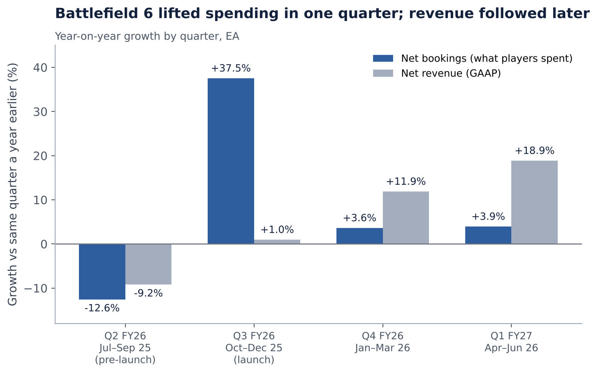
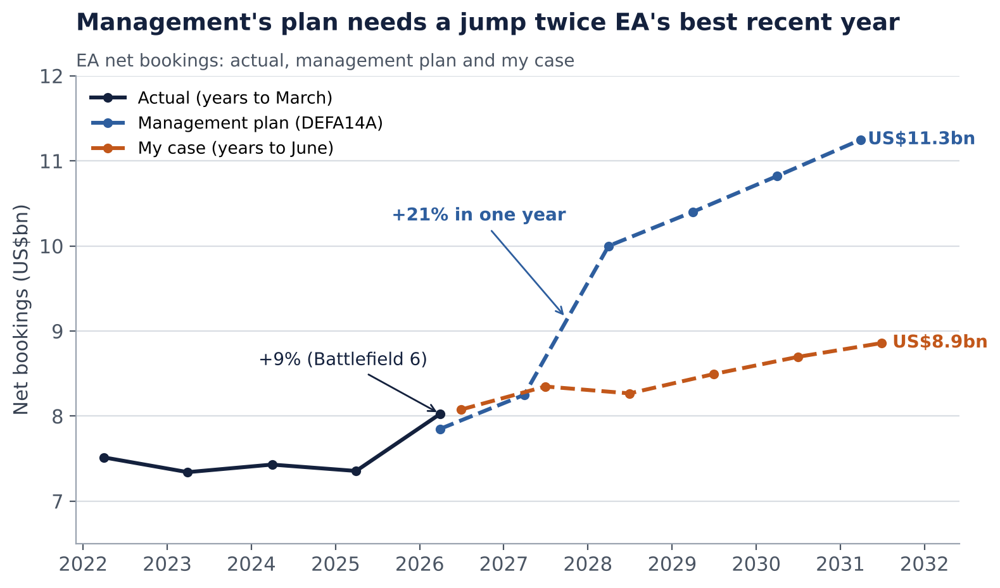
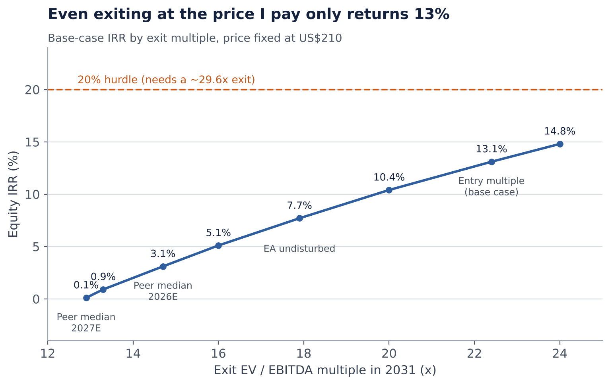

At US$210 per share, I see the US$55bn take-private of Electronic Arts as a deal with limited upside and more downside. My base case returns a 13.1% IRR against a 20% hurdle (not the actual hurdle, just a typical target rate), and that’s only if a buyer in 2031 pays the same 22.4x EBITDA that was roughly paid for the deal. If the exit multiple drifts towards where peers trade, the equity barely gets its money back.

I approached this from the perspective of someone asked whether they would back this deal at US$210.00 in September 2025. I used data available up to 30 October 2026, which let me test the thesis against what has happened since. All returns come from my own LBO model, built from scratch using EA’s filings.

```table
title: Table 1: My case vs management’s plan (net bookings, US$m)
source: Management’s plan from the supplemental merger proxy; my case from my LBO model
---
Net bookings (US$m)	FY27	FY28	FY29	FY30	FY31
Management Plan	8,250	10,000	10,400	10,820	11,250
My Case	8,348	8,267	8,494	8,696	8,859
Differential	1.2%	-17.3%	-18.3%	-19.6%	-21.3%
```

### My thesis

1. **The price is the problem, not the business.** EA is a high-quality, cash-generative franchise owner. But at 22.4x EBITDA, I need a 2031 buyer to pay the same multiple just to earn 13%. A 20% IRR needs a multiple of approximately 29.6x.
2. **Battlefield 6 proved the franchises still work, but growth has not changed.** It was the best-selling shooter of 2025 and lifted FY26 net bookings by 9%. But within two quarters, growth was back to 4%.
3. **Management’s plan needs a year EA has not had recently.** The plan has net bookings jumping 21% in FY28, more than twice the Battlefield 6 year. EA had grown bookings at roughly 3% a year from FY23 to FY26.
4. **Debt cannot close the gap.** The US$18bn is already 7.6x EBITDA at close. Adding more debt barely helps at a 22.4x exit.

## 1. Thesis

I suspect the price plays the largest role in the IRR. My operating case is not bearish. I grow revenue by 4.5% in Year 1, slowing to 2% by Year 5, and expand the EBITDA margin from 33% to 39% as costs fall back towards historical trends. That takes EBITDA from about US$2.4bn to US$3.4bn by June 2031. Even so, the deal only returns 13.1% and 1.85x.

The problem is what I paid for that EBITDA. US$210 is 22.4x my LTM EBITDA, which already adds back stock-based compensation. On reported EBITDA, it is about 31x, against a peer median of 13.3x. Before the bid leaked, EA itself traded at 17.9x on my base case.

About 87% of my base-case gain comes from EBITDA growth valued at the same 22.4x on exit. Only 13% comes from paying down debt. So the IRR depends almost entirely on someone in 2031 paying the entry multiple. If the exit multiple drifts towards EA’s own undisturbed 17.9x, the IRR falls to 7.7%.

### Battlefield 6 proved the franchises work, not that growth has changed

Battlefield 6 was the strongest argument for the deal. It sold over 7 million copies in three days, became the best-selling shooter of 2025, and lifted FY26 net bookings 9% to a record of roughly US$8bn. But the boost was a one-off step, not a new growth rate. In the two quarters that followed, bookings were about 4% higher than a year earlier. That is in line with EA’s usual pace (bookings grew about 3% a year over FY23–FY26), and far below the 21% jump management’s plan needs in FY28.

I also tested this in my model. If revenue grew 80% faster than my base rates every year (about 5.8% a year, faster than EA’s revenue grew in any of FY24 to FY26), the IRR at US$210 rises only to 16.5%.

### More debt does not fix the IRR

It is tempting to fix the IRR with more debt, because US$18bn is only about a third of the equity price. But that is a third of a very high price. In earnings terms, it is 7.6x EBITDA at close and 5.7x after Year 1. Each extra 10% of the price in debt adds about 1 point of IRR at a 22.4x exit, and lowers the IRR if multiples fall. Reaching a 20% hurdle from debt alone needs about 70% of the price borrowed, which equates to 16.0x EBITDA, with interest cover below 1.0x.

### The buyer who can pay this price is not a private equity fund

After the deal, PIF reportedly ends up with about 93% of EA. Silver Lake holds about 5.5% and Affinity about 1.1%. A lot can be inferred from this split. PIF isn’t only buying cash flows: gaming and esports are stated as one of the core pillars of Saudi Vision 2030. A buyer that values EA partly for strategic reasons can justify a price that a fund judged only on returns cannot.

## 2. The deal and its financing

On 29 September 2025, EA agreed to be bought for US$210 a share in cash by a consortium of Saudi Arabia’s Public Investment Fund, Silver Lake and Affinity Partners. It was billed as the largest all-cash sponsor take-private in history.

```table
title: Table 2: Sources and uses (US$bn, my estimates)
---
Sources	US$bn	Uses	US$bn
New debt	18.0	Buy out public shareholders (227.6m shares × US$210)	47.8
New cash equity from the three buyers	~31.2	PIF's shares rolled into the new owner	5.2
PIF rollover (existing shares)	5.2	Repay or defease EA's old US$1.5bn of bonds	~1.1–1.2
EA's own cash used	~1.0–1.3	Fees (banks, Goldman Sachs, original issue discount) and other	~1.3
= Total	~55	Total	~55
```

```table
title: Table 3: The debt package
---
Tranche	Amount	Rate	Matures	Secured
Revolver	US$500m (undrawn)	Not disclosed	2031	Yes
Term loan A-1 / A-2	US$2,167m / US$1,083m	SOFR + 2.50% / + 2.75%	2029 / 2031	Yes
Term loan B (USD)	US$6,125m	SOFR + 3.50%, issued at 98.5	2033	Yes
Term loan B (EUR)	€1,725m (~US$2.0bn)	Euribor + 3.50%, issued at 98.5	2033	Yes
Senior secured notes (USD / EUR)	US$2,875m / €1,080m	7.25% / 6.25%	2033	Yes
Senior unsecured notes	US$2,500m	8.75%	2034	No
= Total funded	Approx. US$18.0bn	Blended: ~7%		
```

Leverage depends on which EBITDA you use. On my basis it is 7.6x, and Moody’s put it at about 8x, according to an IFR article.

## 3. Forecast

### My operating case

1. **Revenue:** +4.5% in FY27, slowing to 2% by FY31, from US$7.5bn to about US$8.8bn.
2. **Margins:** EBITDA margin from 33% to 39%. R&D held at 35% of revenue, below FY26’s 38% but above the 31–32% of FY22 to FY24.
3. **EBITDA:** about US$2.6bn in FY27, rising to US$3.4bn in FY31.
4. **Debt:** cash goes to repaying debt, taking leverage from 7.6x at close to 1.9x by FY31.

I believe this is a reasonable base case. EA’s revenue grew only about 0.5% a year over FY23 to FY26, and net bookings about 3% a year. My growth assumptions are slightly above that record.

### The Battlefield 6 window

Battlefield 6 launched on 10 October 2025, at the start of EA’s biggest quarter. Comparing each quarter of the following year with the same quarter a year earlier shows what one hit can and cannot do.



In the launch quarter, net bookings rose 37.5% to US$3,046m, a record. Revenue rose just 1.0%, because EA deferred US$510m of full-game sales to later months, against US$34m a year earlier. That deferred money turned into revenue in the next two quarters, which is why revenue growth accelerated to 11.9% and 18.9% while bookings growth slowed to about 4%.

PC revenue accelerated from 19% to 30% to 39% over the three quarters after launch. Mobile, which has no Battlefield, fell 4–8% in every quarter. Over the full four quarters, revenue rose 5% and net bookings 9.3%. That is a good year, but it rests on one successful hit whose players faded quickly.

### Management’s FY28 step-up

Management’s plan, disclosed in the merger proxy, requires net bookings of US$11.25bn by FY31, 7% annual growth from FY26’s US$8bn. FY27 looks achievable: it needs only 2.8% on FY26, and Q1 FY27 grew 3.9%. The problem is FY28.



FY28 needs net bookings to jump 21% in one year, with adjusted EBITDA up 40%. That is more than twice the Battlefield 6 year. The merger proxy gives only the numbers, not what drives them. It does not say which games or launches would produce a 21% jump in one year. To be fair, management knows what games are coming and I don’t. Maybe there’s something big lined up for FY28. But I would not be comfortable betting on a growth rate EA hasn’t hit in at least four years just to get to 20%.

## 4. How EA compares

```table
title: Table 4: Gaming peers, EV / EBITDA
subtitle: Prices as of 28–29 October 2026
source: My trading comps workbook (company filings, Yahoo Finance prices, MarketScreener consensus)
---
Company	EV (US$m)	LTM	2026E	2027E
Nintendo	49,805	16.8x	17.7x	16.7x
Capcom	8,997	13.9x	15.6x	13.5x
Konami	17,721	12.8x	13.8x	12.3x
NetEase	55,832	8.6x	7.7x	7.2x
Krafton	5,685	5.0x	4.7x	4.5x
Take-Two	37,209	51.5x	23.2x	16.0x
= Peer median (all eight, incl. Ubisoft and CD Projekt)		13.3x	14.7x	12.9x
EA at US$210	~55,000	31.0x Reported 22.4x Adjusted Basis		
```

One thing to note when comparing EA with this group: the peers are on reported EBITDA, which is after stock-based compensation, so the fair comparison is EA’s 31.0x, not my adjusted 22.4x.

### Precedent takeovers

Microsoft paid about 17.0x forward adjusted EBITDA for Activision Blizzard (2022) and Take-Two about 18.0x for Zynga. At about 20.0x forward on management’s own plan, EA is priced above both. Yet its 24.8% premium was the lowest of the large gaming deals: Activision’s was 45% and Zynga’s 64%. Both of these are true because EA’s shares were at an all-time high before the bid.


Goldman Sachs, EA’s sole financial advisor, published four valuation ranges in its fairness opinion. US$210 sits inside all four, but each relies either on management’s forecasts or on premiums paid in other deals. The other market-based ranges (EA’s own trading range, peers and gaming takeovers on EBITDA) sit below the offer. Goldman did not publish any range for the comparable companies and precedent deals it reviewed.

### Other mega-buyouts


EA is the biggest LBO ever in raw dollars, though RJR Nabisco and TXU were bigger after inflation. What stands out is its funding mix. The big 2006 to 2007 buyouts were about 16–22% equity. EA is about 66%, and only Musk’s Twitter deal comes close. I doubt this is a case of buyers being careful. More likely, lenders only lent what the cash flow can handle, and at 22x EBITDA the price was well above that, so the owners had to cover the rest. The catch is that paying down debt does very little for returns here: about 13% of the gain in my model. The rest has to come from growth and a high exit price.

## 5. Returns

### Base case

My base case returns a 13.1% IRR and 1.85x money over five years, assuming a sale in 2031 at the same 22.4x entry multiple. Debt falls from US$18bn to about US$6.4bn, and leverage from 7.6x to 1.9x. Based on my model, EA can carry the debt; the issue is the equity returns.



The exit multiple is the biggest swing. For every 2.5 turns, the IRR shifts by roughly 3 points. At EA’s undisturbed 17.9x, the IRR falls to 7.7%. At the 2026E peer median of 14.7x, it is 3.1%, and at the 2027E median of 12.9x, 0.1%. Reaching 20% requires a 29.6x exit, more than twice where peers trade today.

```table
title: Table 5: Routes to a 20% IRR, price fixed at US$210 unless stated
---
Route	IRR at a 22.4x exit	IRR at a Lower Exit	What has to be true
Management's plan delivered	20.9%	10.8% at 14.7x 8.6% at 13.3x	FY28 bookings +21%, and a 2031 buyer pays 22x
Approximately US$700m of cost cuts	18.9%	13.5% at 17.9x	Deep R&D cuts that do not hurt the franchises
Cost cuts + 1.8x my growth	22.3%	16.8% at 17.9x	Both at once
R&D cut by 3.5 points of revenue	15.6%	–	20% needs R&D at 24% of revenue, against 31 to 38% historically
Lower price only, exit at entry multiple	14.1% at US$160	–	A lower price barely helps if the exit multiple falls with it
More debt only	20% IRR needs 70% of price as debt	–	16x Leverage
Price US$184.82 (9.8% premium) + 55.6% debt	20.8%	16.8% at the new 19.7x entry	11.2x Leverage at close
Price US$160 + Management plan + US$18bn debt	20% at a 14.7x exit	–	Below the US$168.32 undisturbed price. The board would not sell
```

## 6. Risks and what could make me wrong

### Upside risk

The most likely way I am wrong is that EA becomes a different, faster-growing company under private ownership. A US$700m cost-cutting programme, much of it reportedly from R&D and AI tools, could lift margins well beyond my modelled 39%. Apex Legends showed that live-service assumptions can surprise: EA guided it down about 40% for FY26, and it grew double digits instead. A merger with PIF’s Savvy Games, which Bloomberg reported PIF is weighing, could add mobile scale and real cost savings. And a strategic buyer for a combined business might pay a multiple I would not assume today.

### Downside risk

The downside risks are more concrete:

1. **Two franchises carry the debt.** FC and Madden are about 58% of net bookings and about 70% of franchise EBITDA. FC Ultimate Team spending fell in Q1 FY27, EA’s last public quarter.
2. **Cutting too deep.** In October 2026 EA cut about 400 jobs, closed BioWare’s Edmonton studio and cancelled the next Mass Effect. Cuts that weaken the next FC or Battlefield hit the cash that pays the interest.
3. **GTA VI** launches on 19 November 2026, in EA’s biggest quarter.
4. **Interest rates.** About US$9.4bn of the debt floats on US rates, so each 1-point rise costs about US$94m a year. The Fed raised rates in September 2026.

```table
title: Table 6: Triggers to revisit my view
---
Trigger	Threshold	Effect in my model
Bookings on plan	FY28 net bookings of US$10.0bn or more	20.9% at a 22.4x exit
Cost programme	US$700m run-rate with bookings intact	18.9% at a 22.4x exit
Exit evidence	A publisher sale or peer re-rating at 20x or more	10.4% at 20x on my case
```

## Appendix: financial summary and model notes

```table
title: Table 7: My base case (US$m)
note: Entry: US$210 per share, 22.4x LTM EBITDA, US$18bn of debt. Exit in 2031 at 22.4x. 13.1% IRR and 1.85x money.
---
	Year 1 (2027)	Year 2 (2028)	Year 3 (2029)	Year 4 (2030)	Year 5 (2031)
Revenue	7,870	8,185	8,430	8,641	8,814
Revenue growth	4.5%	4.0%	3.0%	2.5%	2.0%
EBITDA (incl. stock-based pay add-back)	2,594	2,815	3,021	3,220	3,412
EBITDA margin	33%	34%	36%	37%	39%
Total debt	14,845	13,085	11,114	8,899	6,441
Debt / EBITDA	5.7x	4.6x	3.7x	2.8x	1.9x
Interest cover (EBITDA / interest)	2.0x	2.6x	3.1x	3.9x	5.2x
```

```table
title: Table 8: Which EBITDA? The entry multiple on each basis
---
Basis	LTM EBITDA (US$m)	EV / EBITDA at US$210
Reported (operating income + D&A)	1,725	~31x
My basis (+ stock-based compensation)	2,382	22.4x
Management basis (+ change in deferred revenue)	2,613	~21x
Lenders' pro forma (+ ~US$400m planned savings and other add-backs)	3,369	15.9x
```

### Model notes

A quick note on the model. I built it from scratch as practice for LBO modelling, so it’s not a finished, audited model. There are some accounting rough edges in how parts of the three statements link together. The point of this exercise wasn’t a perfect model. It was learning how an LBO fits together, and getting better at reading a real deal and asking whether the numbers actually make sense.

## Sources

1. Electronic Arts, [Merger announcement, 8-K Ex 99.1](https://www.sec.gov/Archives/edgar/data/712515/000114036125036415/ef20056167_ex99-1.htm) (29 Sep 2025). sec.gov
2. Electronic Arts, [Definitive merger proxy, DEFM14A](https://www.sec.gov/Archives/edgar/data/712515/000114036125042872/ny20056157x2_defm14a.htm) (20 Nov 2025). sec.gov
3. Electronic Arts, [Supplemental proxy disclosures, DEFA14A](https://www.sec.gov/Archives/edgar/data/712515/000114036125045524/ef20061216_defa14a.htm) (15 Dec 2025). sec.gov
4. Electronic Arts, [Closing 8-K, credit agreement and notes](https://www.sec.gov/Archives/edgar/data/712515/000114036126031157/ef20079099_8k.htm) (4 Aug 2026). sec.gov
5. Electronic Arts, [Form 10-K, FY2026](https://www.sec.gov/Archives/edgar/data/712515/000162828026033617/ea-20260331.htm) (11 May 2026). sec.gov
6. Electronic Arts, [Form 10-Q, Q1 FY2027](https://www.sec.gov/Archives/edgar/data/712515/000162828026051829/ea-20260630.htm) (3 Aug 2026). sec.gov
7. Electronic Arts, [Q2 FY26 results](https://www.sec.gov/Archives/edgar/data/712515/000071251525000063/earningspressrelease2025_1.htm) (28 Oct 2025). sec.gov
8. Electronic Arts, [Q3 FY26 results](https://www.sec.gov/Archives/edgar/data/712515/000071251526000012/earningspressrelease2026_0.htm) (3 Feb 2026). sec.gov
9. Electronic Arts, [Q4 FY26 results](https://www.sec.gov/Archives/edgar/data/0000712515/000071251526000053/earningspressrelease2026_0.htm) (5 May 2026). sec.gov
10. Electronic Arts, [Q4 and FY23 results](https://www.sec.gov/Archives/edgar/data/712515/000071251523000021/earningspressrelease2023_0.htm) (9 May 2023). sec.gov
11. Electronic Arts, [Battlefield 6 becomes the biggest launch in franchise history](https://www.businesswire.com/news/home/20251016418634/en/Battlefield-6-Shatters-Records-Becoming-the-Biggest-Launch-in-Franchise-History) (16 Oct 2025). businesswire.com
12. Octus, [Primary preview: Electronic Arts](https://octus.com/resources/articles/primary-preview-electronic-arts/) (19 Mar 2026). octus.com
13. Octus, [EA bonds land tight of price talk; US$45bn of demand](https://octus.com/resources/articles/electronic-arts-bonds-land-tight-of-price-talk-in-highly-anticipated-jpmorgan-led-syndication-lbo-debt-financing-gathers-45b-in-demand-from-investors/) (24 Mar 2026). octus.com
14. IFR, [Jumbo EA financing set to level up](https://www.ifre.com/loans/2400524/jumbo-ea-financing-set-to-level-up) (Mar 2026). ifre.com
15. PitchBook, [EA launches leveraged loan backing largest LBO debt deal since the financial crisis](https://pitchbook.com/news/articles/electronic-arts-launches-leveraged-loan-backing-largest-lbo-debt-deal-since-financial-crisis) (Mar 2026). pitchbook.com
16. Game Developer, [Saudi Arabia will own 93.4 percent of EA after buyout](https://www.gamedeveloper.com/business/saudi-arabia-will-own-93-4-percent-of-ea-after-buyout) (3 Dec 2025). gamedeveloper.com
17. VGC, [Saudi Arabia reportedly running low on cash for investments](https://www.videogameschronicle.com/news/saudi-arabia-is-reportedly-running-low-on-cash-for-investments-following-ea-deal) (25 Nov 2025). videogameschronicle.com
18. Mobilegamer.biz / Bloomberg, [Saudi bosses considering merging Savvy and EA](https://mobilegamer.biz/saudi-bosses-are-considering-merging-savvy-and-ea-to-create-a-new-gaming-supergroup-says-bloomberg/) (10 Sep 2026). mobilegamer.biz
19. AP via WDBO, [Electronic Arts to cut 400 jobs, shut down BioWare studio](https://www.wdbo.com/news/trending/electronic-arts-cut-400-jobs-shut-down-development-studio-bioware/KUK6GRHMBNCVXC45LB7KGMOXLU/) (21 Oct 2026). wdbo.com
20. TheSixthAxis, [EA confirms layoffs for Battlefield Studios](https://www.thesixthaxis.com/2026/03/09/ea-confirms-layoffs-for-battlefield-studios-even-with-battlefield-6s-record-sales/) (9 Mar 2026). thesixthaxis.com
21. Microsoft, [Microsoft to acquire Activision Blizzard](https://news.microsoft.com/2022/01/18/microsoft-to-acquire-activision-blizzard-to-bring-the-joy-and-community-of-gaming-to-everyone-across-every-device/) (18 Jan 2022). microsoft.com
22. Dealroom, [The most famous leveraged buyouts in history](https://dealroom.net/blog/the-most-famous-leveraged-buyouts-in-history). dealroom.net

Peer multiples come from my own trading comps workbook, built from company filings, Yahoo Finance prices and MarketScreener consensus. All IRRs come from my LBO model and copies of it with only input cells changed.

## Disclaimer

This piece is personal research, written to build and practise modelling a leveraged buyout analysis. It is not investment advice. My model is simplified and illustrative, and it may contain accounting inaccuracies.
