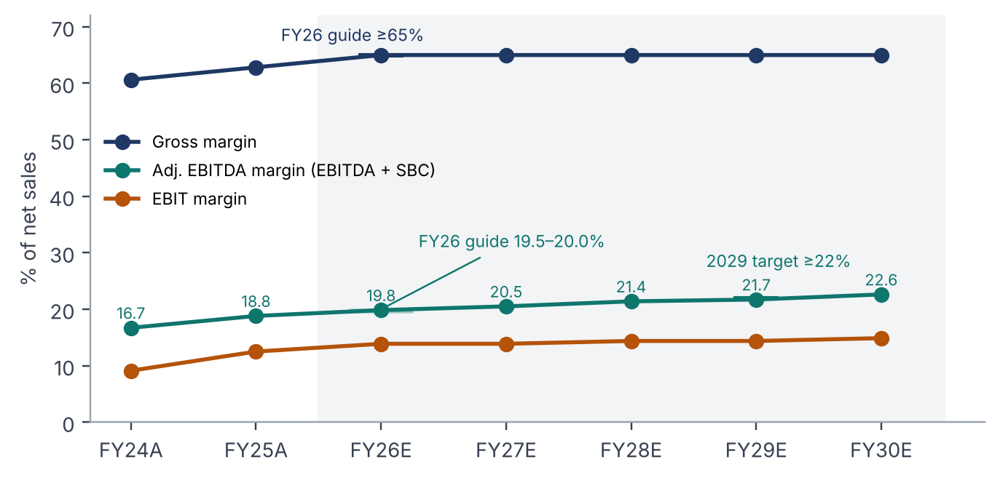
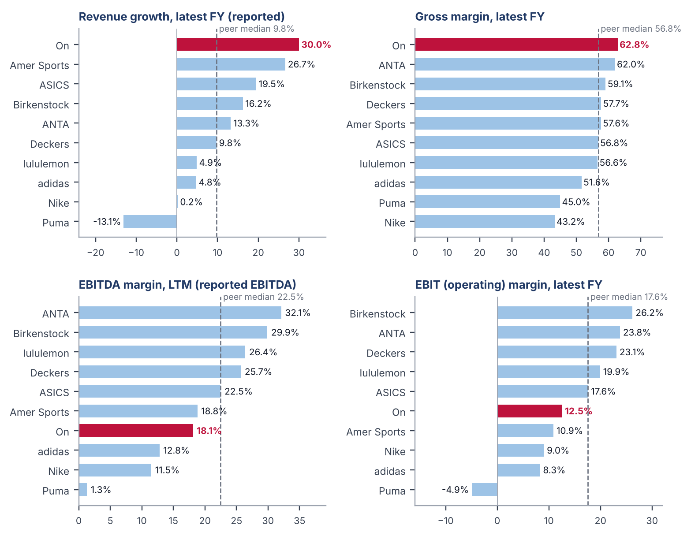

I am starting coverage on On Holding with a Neutral rating and a US$34 price target (exit-multiple DCF, US$34.15), about 3% below the US$35.33 close on 20 October 2026. The median target of the 23 brokers I could find is US$42. My forecasts are close to consensus for FY26 and a little above it for FY27 to FY28, so most of my gap to the consensus comes from valuation.

For FY26 my model is close to the company’s guidance: net sales of CHF 3,513m (guidance CHF 3.47–3.56bn), 21.1% constant-currency growth (guidance “low-20s”), a 65.0% gross margin (guidance at least 65.0%), and an adjusted EBITDA margin of 19.8% (guidance 19.5–20.0%).

### My thesis

1. **My forecasts are close to the company’s and the Street’s.** FY26 is in line with guidance (sales of CHF 3,513m, 21.1% constant-currency growth, a 19.8% adjusted EBITDA margin), and from FY27 I am above consensus on revenue because of APAC.
2. **Brand is On’s only real competitive advantage.** It outsources production to third-party factories in Asia, sells through the same channels as its competitors, and has no network effects or switching costs. An advantage that rests on brand alone can fade, so I don’t assume On keeps its valuation premium.
3. **On is moving sales toward its own stores and website, and I think this adds a risk to its US business.** DTC was 42% of FY25 sales, and management has said it wants it closer to 50%. Even before the Q2 2026 slowdown in wholesale shipments, On’s share of US specialty running was not growing: one specialty retailer’s data shows it at about 5% from H1 2025 to early 2026, while ASICS rose from 5.7% to 8.4% and New Balance and Nike also gained. Holding back wholesale shipments now risks giving up more of that shelf space, which is the same space On won when Nike pulled back from wholesale.
4. **The Street’s target depends on that premium lasting.** I use 8.0x FY30 EBITDA, the peer median today. At my 11.1% WACC, US$42 would need about 10.3x, while a lower discount rate on its own adds only about US$2 per share.

I would turn more positive on signs that the new 2027 shoes are selling well in US stores (retailers re-ordering and wholesale growth picking up), or if the shares fell below about US$29 without a change in the outlook, more than 15% below my target.

## 1. Thesis

### My forecasts are not the problem

On has taken a piece of the market share in running shoes for several years. Constant-currency sales grew 36% in FY25, the gross margin reached a record 65.4% in Q2 2026, and the company has CHF 1.2bn of net cash and a new US$1bn buyback announced. In Q2 it missed on sales and cut FY26 growth guidance to the “low-20s”, mostly because it held back shipments to wholesale partners in the US. At Investor Day in September, it set 2029 targets of at least CHF 5.6bn of sales and an adjusted EBITDA margin of at least 22.0%.

My FY26 sales of CHF 3,513m are -0.1% against consensus and at the midpoint of guidance. For FY27 and FY28, I am above consensus on sales (+3.7% and +6.5%) and adjusted EBITDA (+3.9% and +7.8%), and in line on EBIT. A below-consensus price target with above-consensus revenue means the difference has to come from how the cash flows are valued. Table 1 below holds my cash flows fixed and changes only the discount rate and exit multiple.

```table
title: Table 1: Share price at different discount rates and exit multiples (my cash flows)
base: 11.1% (my WACC) | 8.0x FY30 EBITDA (my base case)
---
Discount rate (USD WACC)	8.0x FY30 EBITDA (my base case)	10.0x	11.7x (Stifel’s multiple)
9.2% (public DCF range)	US$36.46	US$43.84	US$50.11
9.5%	US$36.09	US$43.38	US$49.58
10.1%	US$35.32	US$42.43	US$48.48
11.1% (my WACC)	US$34.15	US$41.00	US$46.83
```

Reducing my WACC to the 9.2–9.7% used in public DCFs adds only about US$2 per share, because 86% of my value is in the terminal value and the terminal value is set by a multiple. Getting to US$42 needs an exit multiple of about 10.3x FY30 EBITDA. I use 8.0x, the median 2027E EV/EBITDA from the peer group. By FY30, my model has On growing at about 15% a year, which looks more like ASICS today (13.2x, 11% growth) or Deckers (7.0x, 7.0% growth) than like On today. The key question is whether On deserves to keep its premium as it slows, and the next two points are why I think it may not.

### Brand is On’s only real advantage

On does not make its own shoes. About 90% of its footwear comes from third-party factories in Vietnam (most of the rest from Indonesia), using fewer than 30 suppliers, the same kind of supply base its competitors use, so it has no cost advantage. It sells through the same specialty running stores and sporting-goods chains as ASICS, Hoka and Brooks, plus its own stores and website, which every large brand now has. There are no network effects in running shoes, and a runner can switch brands at the next purchase at no cost.

While I do agree that a strong brand is worth a lot, it comes at a cost. On’s gross margin (62.8% in FY25, 65.4% in Q2 2026) is the highest in its peer group, which shows how much customers will pay for it today. But a brand advantage has to be paid for (On spent 12.5% of sales on marketing in FY25, more than any peer that discloses that figure), and brand-driven growth can slow quickly. Hoka’s growth went from 59% in Deckers’ FY23 to 16% in FY26.

### The shift to direct sales puts shelf space at risk

Direct-to-consumer was 42% of FY25 sales and a record 45.7% in Q2 2026, and management has said it wants it closer to 50%. DTC earns a higher gross margin and gives On control over pricing, so the shift does make sense on paper. Nike tried a version of this in 2017, cutting hundreds of wholesale accounts. The shelf space it gave up in running stores went largely to On and Hoka, and Nike has spent the last two years trying to win it back.

On is not cutting wholesale accounts the way Nike did, and wholesale still grew about 27% in FY25. But even before the Q2 2026 hold-back (management deliberately cut back how many shoes it shipped to wholesale partners in the US, as some of On’s everyday running shoes were selling to customers more slowly than it wanted, especially in America), On’s share of US specialty running was not growing. One specialty retailer’s data, from Confluence Running, shows On at about 5% from H1 2025 to early 2026, while ASICS rose from 5.7% to 8.4% and New Balance and Nike also gained around 1.5%. Specialty stores are where many runners try and buy their shoes, and if runners switch easily, shelf space given up now may be hard to win back. This part of the thesis can be verified over the next two quarters. If wholesale growth recovers once the hold-back ends and On’s specialty running share starts rising with the Cloudsurfer 3 launch, I would put less weight on this thesis.

## 2. Forecast

")

```table
title: Table 2: My model vs consensus vs guidance
---
CHF m	FY26E model	FY26E cons.	FY26 guidance	FY27E model	FY27E cons.	FY28E model	FY28E cons.
Net sales	3,513	3,515	3,470–3,560	4,338	4,183	5,272	4,951
Gross margin	65.0%	65.2%	≥65.0%	65.0%	n/a	65.0%	n/a
Adj. EBITDA	697	706	~677–712	890	857	1,128	1,047
Adj. EBITDA margin	19.8%	20.1%	19.5–20.0%	20.5%	20.5%	21.4%	21.1%
EBIT	488	490		602	606	758	762
EPS (CHF)	1.26	1.23		1.53	1.49	1.91	1.92
```

The implied H2 gross margin (65.0%) is only slightly above H1 (64.8%) and below the 65.4% On reached in Q2, and the H2 adjusted EBITDA margin (19.4%) is lower than H1 (20.4%). Most of the gap is currency. The franc took about 10 points off reported growth in H1. Q3 consensus of CHF 929.8m is in line with the guidance of about 17% constant-currency growth, which would leave Q4 needing about CHF 901m (+21.1%). That fits management’s comment that Q3 will be weaker than Q4.

APAC is the part of my forecast that I am most uncertain about, because so much depends on it. APAC sales were CHF 511m in FY25 and I have them reaching CHF 2.1bn in FY29, roughly four times bigger. That one region accounts for almost half of all the sales growth in my model over the next four years, and its share of On’s sales goes from 17% to a third. I don’t assume today’s growth rate continues. APAC sales doubled in FY25 and grew 55% in Q2 2026. I have growth slowing each year, from 52% in FY26 to 20% by FY30, the way it usually does once a business gets bigger. What gives me some confidence in the early years is that On is growing in China mostly through its own stores (about 80 today, with over 100 planned by the end of 2026), and it has kept prices high, refusing to join the heavy discounting during China’s big shopping festivals.

This is also why I end up above the consensus. My FY29 sales of CHF 6.25bn are higher than both management’s CHF 5.6bn target and the roughly CHF 5.8bn consensus implies, and most of that gap is APAC. If APAC grows more slowly than I modelled, my sales forecast comes down. However, the valuation is less sensitive than one might think. Cutting every growth rate by 10% only lowers my value from US$34 to US$32 (see Section 4: Valuation).



## 3. How On compares with its peers



On grew 30.0% in FY25 against a peer median of 9.8%, and its gross margin of 62.8% was the highest of the ten companies (median 56.8%). Below gross profit it looks much weaker. Its LTM EBITDA margin of 18.1% is below the 22.5% median, and its FY25 EBIT margin of 12.5% is about half of Birkenstock’s (26.2%), ANTA’s (23.8%) and Deckers’ (23.1%). On spends 50.3% of sales on operating costs, the most in the group and 12 points above the median. Deckers has a gross margin about 5 points lower than On’s and still earns almost twice its EBIT margin.

")

Marketing is a large part of the gap. On spent 12.5% of sales on it in FY25, the most of any peer that discloses a comparable figure and about 3.7% above their median. I would caution against putting too much weight on this, as definitions of marketing differ across peers, but the direction fits the brand argument: On has to keep spending to keep the brand where it is.

The peer comparison also shows where I was more conservative. On spends about half of every franc of sales on operating expenses, against about 38% for the typical peer. If On became as efficient as its peers, its profit margins would be much higher than I have them. In my model, On’s EBITDA margin reaches 20.5% by FY30, which is still below what the typical peer earns today (22.5%), and well below Deckers (about 26%). Every extra percentage point of margin I gave On by FY30 would add roughly US$1.70 to my share price. It would take about 4.7% to get my value up to the Street’s US$42.

I haven’t assumed this because management has been clear that it will keep spending on growth, including marketing, new stores, football and golf. Its own target is an adjusted EBITDA margin of at least 22% by 2029, and that is what I model. If On starts showing lower costs as a share of sales before then, I would need to raise my numbers.

## 4. Valuation

I value On with a five-year DCF in US dollars. The WACC is 11.1%: a 5.1% US Treasury yield, a beta of 1.44 against the S&P 500 and a 4.5% equity risk premium give an 11.5% cost of equity, and leases make up about 5% of capital at an after-tax cost of 4.3%. I discounted the free cash flow in dollars because the inputs are dollar-based and my forecast holds the CHF/USD rate flat after FY26. New leases are charged like capex and the lease liability is deducted from enterprise value.

```table
title: Table 3: From enterprise value to price per share
---
	Exit multiple (base)	Perpetuity growth
Terminal assumption	8.0x FY30 EBITDA	3.5% growth
Implied cross-check	5.5% perpetual growth	5.5x FY30 EBITDA
PV of FCF	1,237.9	1,237.9
PV of terminal value	7,593.6	5,514.7
= Enterprise value	8,831.5	6,752.6
Add: cash, less: pension deficit and leases	635.0	635.0
= Equity value (CHF m)	9,466.5	7,387.6
= Price per share (US$, 0.8246 CHF/USD, 336.1m shares)	US$34.15	US$26.65
Vs current price	-3.3%	-24.6%
```

I use the exit method for my target. The perpetuity method gives about US$27 because it grows FY30 free cash flow at 3.5% forever, while in FY30 On is still reinvesting like a company growing at 15% a year (CHF 504m of capex and new leases against CHF 407m of D&A).

```table
title: Table 4: Exit-multiple DCF, price per share (US$)
subtitle: Rows: exit multiple. Columns: WACC.
base: 8.0x | 11.1%
---
Exit multiple	10.1%	10.6%	11.1%	11.6%	12.1%
7.0x	31.76	31.24	30.73	30.23	29.75
7.5x	33.54	32.98	32.44	31.91	31.40
8.0x	35.32	34.73	34.15	33.59	33.04
8.5x	37.10	36.47	35.87	35.27	34.69
9.0x	38.87	38.22	37.58	36.95	36.34
```

```table
title: Table 5: Revenue sensitivity, price per share (US$)
subtitle: Rows: change to every region’s growth rate. Columns: WACC.
base: +0% | 11.1%
---
Growth toggle	10.1%	10.6%	11.1%	11.6%	12.1%
-30%	29.40	28.92	28.46	28.00	27.56
-20%	31.22	30.71	30.21	29.73	29.25
-10%	33.19	32.65	32.11	31.59	31.08
+0%	35.32	34.73	34.15	33.59	33.04
+10%	37.61	36.97	36.36	35.75	35.16
+20%	40.07	39.39	38.73	38.08	37.45
+30%	42.72	41.99	41.28	40.58	39.90
```

The revenue table answers the most obvious objection to my APAC numbers. If every regional growth rate is 10% lower (APAC FY27 at 45% instead of 50%), the value falls to US$32, and a 30% cut gives US$28.5. Under any reasonable growth assumption, I get closer to the current share price.

```chart
type: range
title: Figure 5: Valuation summary, implied value per share (US$)
prefix: US$
decimals: 2
marker: 35.33
marker_label: Share price (20 Oct 2026)
---
Method	25th percentile	Median	75th percentile
# Discounted cash flow
DCF, perpetuity growth (10.1–12.1% WACC, 2.5–4.5% growth)	24.81	26.65	28.77
DCF, exit multiple (10.1–12.1% WACC, 7.0–9.0x EV/EBITDA)	31.91	34.15	36.34
# Public company comparables
LTM EV / Revenue	19.22	28.44	34.81
2026E EV / Revenue	17.65	25.92	30.11
2027E EV / Revenue	20.09	29.47	32.14
LTM EV / EBITDA	21.54	27.22	34.99
2026E EV / EBITDA	19.03	23.01	32.67
2027E EV / EBITDA	22.49	25.43	30.57
LTM P / E	25.96	36.99	48.26
2026E P / E	18.26	24.69	35.98
2027E P / E	21.16	26.21	43.11
# Precedent transactions
Precedents, EV / LTM Revenue	17.35	30.07	40.45
Precedents, EV / LTM EBITDA	28.93	42.85	47.48
```

Applying the peer median multiple to On’s forecasts gives only US$23–26. The median of 13 sportswear and footwear deals since 2017 (16.0x LTM EBITDA) gives about US$36, roughly today’s price, which means the shares already trade at what a buyer of the whole company has historically paid.

## 5. Risks and what could make me wrong

The main upside risk is that On keeps its premium valuation and still trades at 10–11x EBITDA in 2030, meaning the shares would be worth US$41–44 on my cash flows. Other upside risks are a gross margin above 65.0% (each 100 basis points in FY27 is about CHF 43m of EBITDA), operating costs falling towards peer levels, and LightSpray, On’s robotic production line in South Korea, becoming a real manufacturing advantage if it is scaled up.

On the downside, APAC could slow faster than I assume, On could keep losing ground in US specialty running, brand heat could fade among the lifestyle buyers who have driven part of its growth, and marketing could go above 14% of sales as football and golf launch. About 90% of its footwear is made in Vietnam, so US tariff changes hit it directly, and further franc strength due to differences in inflation may lower reported earnings.

```table
title: Table 6: What to watch in the Q3 results (17 November 2026)
---
Metric	Last quarter (Q2 26)	Guidance / consensus for Q3	What my model needs	What would make me wrong
Net sales	CHF 850.3m, +21.6% cc	~17% cc; consensus CHF 929.8m (+17.0%)	Q3 at consensus, then Q4 ~CHF 901m (+21%)	Below CHF 900m, or a cut to the FY range
FY26 guidance	Cut to “low-20s” cc, CHF 3.47–3.56bn	Reiterated at Investor Day	CHF 3,513m (midpoint)	Another cut (bearish) or a raise (bullish)
Wholesale growth	+12.7% cc (Q1 +25.1%)	Weakest quarter of the year	Recovery starting in Q4	Wholesale still slowing in the Q4 outlook
DTC share of sales	45.7%	Rising toward ~50%	Rising	Rising fast while wholesale shrinks (shelf-space risk)
Americas growth	+13.0% cc (Q1 +17.1%)	Not guided	~9% cc in H2	Below ~9%, or weak US sell-through comments
APAC growth	+54.7% cc	Not guided	52% cc for FY26	Below ~45%, or China store openings slowing
Gross margin	65.4%	≥65.0% for FY26	65.2% in H2	Below 65%: full-price argument weakens
Adj. EBITDA margin	19.8%	19.5–20.0% FY; consensus 20.1%	19.4% in H2	Above 20.5% (bullish) or below 19% (bearish)
Tariff refunds	Expected during H2	Up to ~CHF 53m, excluded from guidance	Excluded	Strip them out before judging the margin
2027 outlook	Product refresh, Cloudsurfer 3 from Oct	Spring 2027 order book	Americas +14% in FY27	Weak order book or retailer caution
```

The two lines that matter most for my thesis are wholesale and gross margin. If wholesale steadies and the gross margin stays at 65.0% or above, the shelf-space risk looks smaller and I would move closer to the consensus numbers. If wholesale keeps falling while DTC grows quickly, it supports my view that On is giving up ground in US stores.

## Appendix: financial summary

```table
title: Table 7: My model summary (CHF m)
---
	FY24A	FY25A	FY26E	FY27E	FY28E	FY29E	FY30E
Income statement
Net sales	2,318.3	3,014.0	3,513.0	4,338.4	5,272.3	6,253.9	7,197.3
growth, reported	29.4%	30.0%	16.6%	23.5%	21.5%	18.6%	15.1%
growth, constant currency	33.2%	35.6%	21.1%	23.5%	21.5%	18.6%	15.1%
Gross profit	1,405.7	1,893.7	2,283.5	2,820.0	3,427.0	4,065.0	4,678.3
gross margin	60.6%	62.8%	65.0%	65.0%	65.0%	65.0%	65.0%
Adj. EBITDA	387.6	567.1	697.2	889.9	1,128.3	1,358.6	1,628.3
margin	16.7%	18.8%	19.8%	20.5%	21.4%	21.7%	22.6%
EBIT	211.5	377.1	487.8	602.5	758.5	899.7	1,071.4
margin	9.1%	12.5%	13.9%	13.9%	14.4%	14.4%	14.9%
Net income	242.2	203.7	422.2	514.0	642.4	758.2	897.3
EPS, diluted (CHF)	0.72	0.61	1.26	1.53	1.91	2.26	2.67
Cash flow and balance sheet
Cash from operations	510.6	359.6	491.5	719.1	915.5	1,121.0	1,362.8
PP&E capex	-60.5	-72.9	-105.4	-130.2	-158.2	-187.6	-215.9
Lease payments	-51.3	-69.9	-93.8	-111.4	-155.7	-205.2	-264.0
Cash	924.3	1,019.9	1,281.1	1,721.7	2,281.3	2,963.8	3,797.7
Lease liabilities	347.6	521.5	638.5	744.0	799.2	844.2	868.0
Total equity	1,391.8	1,632.4	2,136.7	2,752.1	3,517.7	4,422.0	5,487.5
```

## Sources

1. On, Form 20-F for FY2025. [sec.gov](https://www.sec.gov/Archives/edgar/data/1858985/000185898526000008/onholdingag-20251231.htm)
2. On, Q2 2026 results release (11 Aug 2026). [press.on-running.com](https://press.on-running.com/on-reports-results-for-the-second-quarter-and-six-month-period-ended-june-30-2026)
3. Seeking Alpha, On targets CHF 5.6bn sales by 2029, authorizes US$1bn buyback (22 Sep 2026). [seekingalpha.com](https://seekingalpha.com/news/4645237-on-holding-targets-chf-56b-sales-by-2029-authorizes-1b-buyback)
4. De Belegger, On Holding US$1bn buyback, margin and valuation. [debelegger.nl](https://www.debelegger.nl/post/on-holding-1-miljard-inkoop-2029-marge-waardering)
5. MarketScreener, On Holding finances and consensus (16 Oct 2026). [marketscreener.com](https://uk.marketscreener.com/quote/stock/ON-HOLDING-AG-126877786/finances/)
6. StockAnalysis, ONON forecast and ratings. [stockanalysis.com](https://stockanalysis.com/stocks/onon/forecast/)
7. MarketBeat, ONON price targets. [marketbeat.com](https://www.marketbeat.com/stocks/NYSE/ONON/price-target/)
8. Investing.com, On Holding earnings and Q3 consensus. [investing.com](https://www.investing.com/equities/on-holding-earnings)
9. SGB Online, On Holding faces US wholesale growing pains. [sgbonline.com](https://sgbonline.com/exec-on-holding-faces-u-s-wholesale-growing-pains/)
10. Confluence Running, run-specialty market share 2025–YTD 2026. [confluencerunning.com](https://www.confluencerunning.com/blogs/professional-development/market-share-run-specialty-industry-numbers-from-confluence-running-2025-ytd-2026)
11. Keenai, Equity recommendation: On Holding. [keenaiglobal.com](https://www.keenaiglobal.com/en-sg/keensights/equity-recommendation-on-holding-ag-onon-us)
12. Universidade Católica Portuguesa, Equity valuation of On (Gerke thesis). [ciencia.ucp.pt](https://ciencia.ucp.pt/en/studentTheses/equity-valuation-71/)
13. Nike, Form 10-K for fiscal 2026 (demand creation expense). [sec.gov](https://www.sec.gov/Archives/edgar/data/320187/000032018726000088/R3.htm)
14. adidas, Annual Report 2025 (marketing and point-of-sale expenses). [report.adidas-group.com](https://report.adidas-group.com/2025/en/)
15. Deckers Brands, Form 10-K for fiscal 2026. [sec.gov](https://www.sec.gov/Archives/edgar/data/910521/000162828026037664/R26.htm)
16. lululemon, Form 10-K for fiscal 2025 (advertising expenses). [sec.gov](https://www.sec.gov/Archives/edgar/data/1397187/000139718726000020/R94.htm)
17. ASICS, Summary of consolidated financial statements FY2025. [assets.asics.com](https://assets.asics.com/system/libraries/4124/Summary%20of%20Consolidated%20Financial%20Statements%20For%20the%20Fiscal%20Year%20Ended%20December%2031,%202025%20%28Japan%20GAAP%29.pdf)
18. ANTA Sports, 2025 annual results announcement (HKEX). [hkexnews.hk](https://www1.hkexnews.hk/listedco/listconews/sehk/2026/0409/2026040900840.pdf)
19. Birkenstock, Form 20-F for fiscal 2025. [sec.gov](https://www.sec.gov/Archives/edgar/data/1977102/000119312525323599/R124.htm)
20. stockanalysis.com, standardised financials for peers (accessed 19 Oct 2026). [stockanalysis.com](https://stockanalysis.com/stocks/deck/financials/)

Peer and precedent data come from my Comps workbook, compiled from company filings, deal announcements and public market data (as of 20 Oct 2026). Broker price targets and ratings come from public aggregators and press write-ups; I have not seen the underlying broker reports. Peers and consensus data are aggregated using Claude Code.

## Disclaimer

I chose On Holding because I am a fan of its products and wear them myself, and because modelling a company I already know as a customer seemed a good way to practise building a three-statement model and DCF and to learn more about the sportswear industry. This note is the result of that exercise.

Being a customer may bias my view of the brand. I have tried to offset that by basing my forecasts on company filings, guidance and consensus, and by setting out where I think I could be wrong.

This note is personal research. It is not investment advice, a recommendation to buy or sell any security, or an offer of any kind. I am not a licensed investment adviser. The forecasts are my own estimates built from public information, and they may be wrong. Broker views are taken from public write-ups and aggregators, and any errors in summarising them are mine. I do not hold a position in On Holding AG at the time of writing. Please do your own research.
