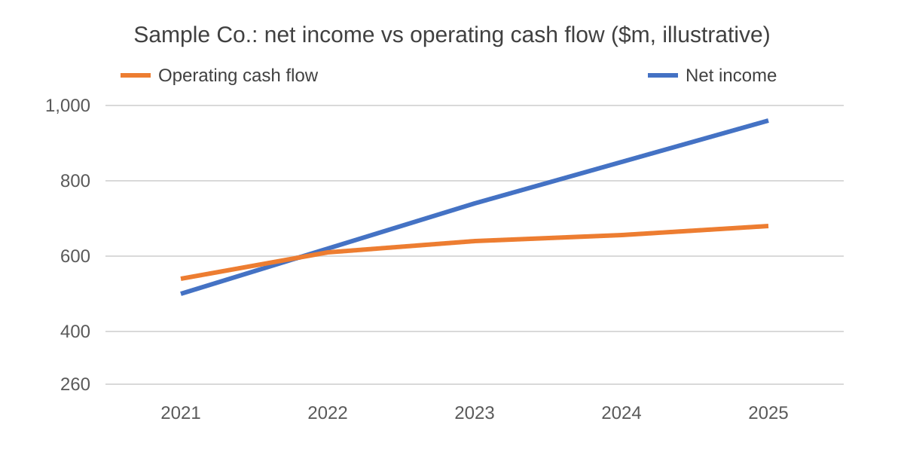

<p class="callout-sample">Sample piece shipped with the site. It shows an uploaded image with a caption, a stacked chart and a pull quote. Replace it with your own work or delete it in the admin panel.</p>

Most people read an annual report from the front. The income statement comes first, earnings per share is the number in the press release, and by the time the notes begin, attention has run out. That order is backwards. The notes are where the business is described in its own numbers.

## Start with segments

Consolidated revenue tells you how big a company is. The segment note tells you what it actually is. A company growing 8% overall can be one business growing 25% attached to another shrinking slowly.

```chart
type: stacked
title: Revenue by segment, Sample Co.
prefix: $
suffix: bn
decimals: 1
source: Illustrative data
---
Year, Core, Services, New products
2021, 6.0, 2.1, 0.4
2022, 6.1, 2.4, 0.8
2023, 6.0, 2.8, 1.3
2024, 5.9, 3.1, 1.9
2025, 5.8, 3.5, 2.6
```

> The consolidated number is an average. Averages hide the one segment that will matter most in five years.

## Then the cash flow statement

Earnings are an opinion; cash is a fact. Compare operating cash flow with net income over several years. When the gap widens, look at receivables, inventory and capitalised costs before anything else.



## Three schedules worth finding every time

1. **Debt maturities.** When does the company need to refinance, and at what rates was the existing debt raised?
2. **Lease commitments.** Operating leases are debt in everything but name for retailers, airlines and restaurants.
3. **Share-based compensation.** It is a real cost, even though it is added back in most adjusted metrics.
